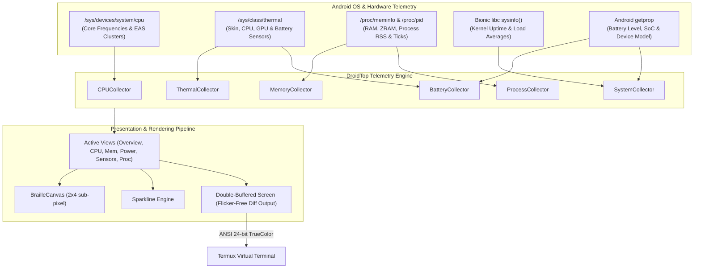

<div align="center">

# 🤖 DroidTop

### A `btop`-like Modern TUI Resource Monitor Crafted for Android & Termux

[](https://python.org)
[](https://developer.android.com)
[](https://termux.dev)
[](https://github.com)
[](https://opensource.org/licenses/MIT)
[-brightgreen?style=for-the-badge)](https://github.com)

<p align="center">
  <b>High-resolution sub-pixel Braille charts • Heterogeneous SoC clusters • Android ZRAM • Battery & Thermal Hub • SGR Touchscreen Support</b>
</p>

[Key Features](#-key-features) •
[Why DroidTop?](#-why-droidtop) •
[Screenshots](#-interface-showcase) •
[Quick Start](#-quick-start) •
[Controls](#-controls--navigation) •
[Themes](#-themes) •
[Architecture](#-architecture) •
[FAQ](#-faq)

---

</div>

```
  ____            _     _ _____             
 |  _ \ _ __ ___ (_) __| |_   _|__  _ __    
 | | | | '__/ _ \| |/ _` | | |/ _ \| '_ \   
 | |_| | | | (_) | | (_| | | | (_) | |_) |  
 |____/|_|  \___//_|\__,_| |_|\___/| .__/   
                                   |_|      
```

**DroidTop** brings the beloved, high-fidelity experience of desktop monitors like **`btop`** directly to your pocket. Built from the ground up for the Android ecosystem, DroidTop solves the unique challenges of mobile Linux: strict SELinux sandbox restrictions, asymmetric CPU scheduling (**big.LITTLE / DynamIQ**), thermal throttling in palm-held devices, and compressed **ZRAM swap**.

---

## 🌟 Key Features

| Feature | Description |
|---|---|
| ⚡ **Heterogeneous SoC Telemetry** | Auto-detects **Little (Efficiency)**, **Big (Performance)**, and **Prime (Super)** core clusters with live MHz frequencies and WALT/EAS scheduler residency. |
| 📈 **Sub-Pixel Braille Graphs** | Silky-smooth $2\times4$ sub-pixel plotting canvas (`U+2800..U+28FF`) with TrueColor multi-point gradients. |
| 🧠 **RAM & Android ZRAM Monitor** | Real-time physical RAM breakdown alongside Android's compressed **ZRAM Swap** and Low Memory Killer (LMK) stats. |
| 🔋 **Battery & Power Diagnostic Hub** | Live charge percentage, charging status glyphs (`⚡`/`🔋`), terminal voltage ($V$), battery temperature ($^\circ\text{C}$), and hardware cycle counts. |
| 🌡️ **Chassis Skin & Component Thermals** | Queries up to 70+ hardware thermal sensors including **Chassis Skin** (`shell_front`, `shell_back`, `shell_frame`), **CPU Cores**, **GPU**, and **DDR RAM**. |
| ⚙️ **Interactive Process Manager** | Real-time fuzzy filtering (`/`), multi-column sorting (`s`/`r`), viewport scrolling, and signal management (`k`: SIGKILL with confirmation, `t`: SIGTERM). |
| 👆 **Touch & Mouse Tracking** | Native Termux touchscreen support via SGR 1006 mouse protocol: tap tabs, click sort headers, tap processes, or swipe to scroll. |
| 📱 **Responsive Mobile Auto-Layout** | Seamlessly adapts between a compact vertical stacked layout for portrait phones and a rich multi-column grid for tablets, landscape, or desktop SSH. |
| 🎨 **8 Curated TrueColor Palettes** | Includes `btop`, `oled` (true #000000 pitch-black AMOLED battery saver), `cyberpunk`, `dracula`, `nord`, `gruvbox`, `matrix`, and `monokai`. |
| 🪶 **Zero External Dependencies** | Pure Python 3 using standard library syscalls and Bionic libc bindings—installs in seconds without hefty C++ compile times. |

---

## 💡 Why DroidTop?

Standard desktop tools like `btop` and `htop` were architected for traditional workstation Linux kernels. On modern Android (Android 10 through 16+):

> [!WARNING]
> Android mounts `/proc` with `hidepid` and enforces strict SELinux `untrusted_app` policies that block unprivileged access to `/proc/stat`, `/proc/loadavg`, `/proc/uptime`, `/proc/net/dev`, and `/proc/diskstats`.

As a result, standard `btop` typically crashes, terminates with permission errors, or displays completely blank 0% values.

### The DroidTop Solution:
1. **Direct Bionic `sysinfo()` Syscalls**: Bypasses blocked `/proc/loadavg` and `/proc/uptime` by executing direct C-level libc calls via `ctypes` to retrieve kernel uptime and 1/5/15-minute load averages with zero overhead.
2. **Energy-Aware Scheduler Telemetry**: Computes exact cluster frequency load by sampling `/sys/devices/system/cpu/cpufreq/policy*/stats/time_in_state` and instantaneous core clock speeds.
3. **Hardware Sensor Auto-Discovery**: Maps dozens of thermal zones into logical human categories—letting you know how hot your phone feels in hand (`shell_max`) before thermal throttling kicks in.
4. **Android ZRAM Intelligence**: Accurately tracks compressed swap in memory, the backbone of Android multitasking.

---

## 🖥️ Interface Showcase

### 1. Master Overview (Portrait Mobile Layout)
```text
 DROIDTOP v1.0.0                          Up: 17d 23h 39m  Load: 3.49 2.89 2.90 
 [1] Overview [2] CPU Cores [3] Mem & Disk [4] Battery [5] Sensors [6] Processes [1.00s] [btop] 
╭─ CPU ────────────────────────────────────────────────────────────────  63.2% ╮
│ ⠀⠀⠀⠀⠀⠀⠀⠀⠀⠀⠀⠀⠀⠀⠀⠀⠀⠀⠀⠀⠀⠀⠀⠀⠀⠀⠀⠀⠀⠀⠀⠀⠀⠀⠀⠀⠀⠀⠀⠀⠀⠀⠀⠀⠀⠀⠀⠀⠀⠀⠀⠀⠀⠀⠀⠀⠀⠀⠀⠀⠀⠀⠀⠀⠀⠀⠀⠀⠀⠀⠀⠀⠀⠀⠀⢀ │
│ ⠀⠀⠀⠀⠀⠀⠀⠀⠀⠀⠀⠀⠀⠀⠀⠀⠀⠀⠀⠀⠀⠀⠀⠀⠀⠀⠀⠀⠀⠀⠀⠀⠀⠀⠀⠀⠀⠀⠀⠀⠀⠀⠀⠀⠀⠀⠀⠀⠀⠀⠀⠀⠀⠀⠀⠀⠀⠀⠀⠀⠀⠀⠀⠀⠀⢀⣀⣀⣀⣀⣀⣀⣀⣀⣀⣾ │
│ Little: 93%  Big: 42%  Prime:  8%                                            │
│ Avg: 1415MHz [██████████████████████████████████▏                   ] 63.2%  │
╰──────────────────────────────────────────────────────────────────────────────╯
╭─ BATTERY & THERMAL ───────────────────────────────────────── 77% Discharging ╮
│ ⚡  77% (4.15V) │ Skin: 34.1°C │ CPU: 39.2°C │ GPU: 38.0°C                    │
╰──────────────────────────────────────────────────────────────────────────────╯
╭─ PROCESSES ───────────────────────────────────────────────────────── 3 total ╮
│ PID    USER      CPU%     RSS  COMMAND                                       │
│ 12959  u0_a376   0.0%   17.4M  python3 -c from droidtop.app import DroidTop. │
│ 24690  u0_a376   0.0%    4.9M  /data/data/com.termux/files/usr/bin/bash -l   │
│ 31859  u0_a376   0.0%  302.7M  /data/data/com.termux/files/usr/glibc/lib/ld-.│
╰──────────────────────────────────────────────────────────────────────────────╯
 [1-6] Tabs  [s] Sort  [r] Rev  [/] Filter  [k] Kill  [m] Theme  [?] Help  [q] Quit  
```

### 2. CPU Heterogeneous Cores & Clusters View
```text
╭─ CPU: 7s Gen 3 (SM7635) ─────────────────────────────────────── LOAD:  40.3% ╮
│ SoC: 7s Gen 3 │ Cores: 8 │ Uptime: 17d 23h 39m │ LoadAvg: 3.15, 2.84, 2.89   │
│ ⠀⠀⠀⠀⠀⠀⠀⠀⠀⠀⠀⠀⠀⠀⠀⠀⠀⠀⠀⠀⠀⠀⠀⠀⠀⠀⠀⠀⠀⠀⠀⠀⠀⠀⠀⠀⠀⠀⠀⠀⠀⠀⠀⠀⠀⠀⠀⠀⠀⠀⠀⠀⠀⠀⠀⠀⠀⠀⠀⠀⠀⠀⠀⠀⠀⠀⠀⠀⠀⠀⠀⠀⠀⠀⠀⢠ │
│ ⠀⠀⠀⠀⠀⠀⠀⠀⠀⠀⠀⠀⠀⠀⠀⠀⠀⠀⠀⠀⠀⠀⠀⠀⠀⠀⠀⠀⠀⠀⠀⠀⠀⠀⠀⠀⠀⠀⠀⠀⠀⠀⠀⠀⠀⠀⠀⠀⠀⠀⠀⠀⠀⠀⠀⠀⠀⠀⠀⠀⠀⠀⠀⠀⠀⠀⠀⠀⠀⠀⠀⠀⠀⠀⠀⣸ │
│ ⠀⠀⠀⠀⠀⠀⠀⠀⠀⠀⠀⠀⠀⠀⠀⠀⠀⠀⠀⠀⠀⠀⠀⠀⠀⠀⠀⠀⠀⠀⠀⠀⠀⠀⠀⠀⠀⠀⠀⠀⠀⠀⠀⠀⠀⠀⠀⠀⠀⠀⠀⠀⠀⠀⠀⠀⠀⠀⠀⠀⠀⠀⠀⠀⠀⢀⣀⣀⣀⣀⣀⣀⣀⣀⣀⣿ │
│ ─── Heterogeneous Core Clusters (EAS / WALT) ───                             │
│ Little (Efficiency)  Cores:[0,1,2,3]  441-1804MHz [███▍                      │
│ Big (Performance)    Cores:[4,5,6]  480-2400MHz [███████████████████████████ │
│ Prime (Super)        Cores:[7    ]  480-2496MHz [██▎                         │
│ ─── Individual Core Frequencies & Activity ───                               │
│ CPU 0    595 MHz [████                                ]  11.3%               │
│ CPU 1    595 MHz [████                                ]  11.3%               │
│ CPU 2    595 MHz [████                                ]  11.3%               │
│ CPU 3    595 MHz [████                                ]  11.3%               │
│ CPU 4   2208 MHz [████████████████████████████████▍   ]  90.0%          ▇    │
│ CPU 5   2208 MHz [████████████████████████████████▍   ]  90.0%          ▇    │
│ CPU 6   2208 MHz [████████████████████████████████▍   ]  90.0%          ▇    │
╰──────────────────────────────────────────────────────────────────────────────╯
```

---

## ⚡ Quick Start

### 1. Requirements
- Android 8.0+ (Oreo through Android 16+)
- [Termux](https://github.com/termux/termux-app/releases)
- Python 3.8+ (`pkg install python`)

### 2. Installation

#### Direct Termux Installation
```bash
# Clone the repository
git clone https://github.com/developer/droidtop.git ~/droidtop

# Symlink to bin for global execution
ln -sf ~/droidtop/bin/droidtop $PREFIX/bin/droidtop

# Run anywhere!
droidtop
```

#### Pip / Python Package Installation
```bash
cd ~/droidtop
pip install -e .
droidtop
```

---

## 🕹️ CLI Options

```text
usage: droidtop [-h] [-v]
                [-t {btop,oled,cyberpunk,dracula,nord,gruvbox,matrix,monokai}]
                [-r RATE] [--view {overview,cpu,memory,power,thermal,proc}]

options:
  -h, --help            Show this help message and exit
  -v, --version         Show program's version number and exit
  -t, --theme THEME     Choose UI theme (default: btop)
  -r, --rate RATE       Refresh interval in seconds (default: 1.0)
  --view VIEW           Launch directly into a specific view (overview, cpu, memory, power, thermal, proc)
```

---

## ⌨️ Controls & Navigation

### Global Shortcuts
| Key | Action |
|---|---|
| `1` – `6` | Direct switch to tab (**Overview**, **CPU**, **Memory**, **Power**, **Sensors**, **Processes**) |
| `Tab` / `Shift-Tab` | Cycle forwards / backwards through tabs |
| `←` / `→` | Previous / Next tab |
| `Touch / Tap` | Tap any tab, bottom button, or process row directly on screen |
| `+` / `-` | Increase / decrease refresh frequency ($0.25\text{s} - 5.0\text{s}$) |
| `Space` or `p` | Pause / resume live background updates |
| `m` or `F2` | Open interactive Theme Switcher modal |
| `?` or `F1` | Toggle Help & Keybinding reference dialog |
| `q` or `Ctrl+C` | Gracefully restore terminal and exit |

### Process Manager Shortcuts
| Key | Action |
|---|---|
| `j` / `k` or `↑` / `↓` | Move selected process cursor |
| `PageUp` / `PageDn` | Scroll process list by 10 rows |
| `Home` / `End` | Jump to first / last process |
| `/` | Open live search filter bar |
| `c` | Clear search filter |
| `s` | Cycle sort column (`CPU%` $\rightarrow$ `MEM%` $\rightarrow$ `PID` $\rightarrow$ `NAME` $\rightarrow$ `THREADS`) |
| `r` | Invert sort order (Ascending $\leftrightarrow$ Descending) |
| `k` or `Delete` | Send `SIGKILL` (with safety confirmation dialog) |
| `t` | Send `SIGTERM` (graceful stop) |
| `i` | Send `SIGINT` (keyboard interrupt) |

---

## 🎨 Themes

DroidTop includes 8 handcrafted 24-bit TrueColor themes. Switch between them instantly by pressing `m` or passing `-t <name>`:

| Theme | Display Name | Background | Primary Accent | AMOLED Friendly |
|---|---|:---:|:---:|:---:|
| `btop` | **Btop Default** | `#141721` | Cyan & Purple | ❌ |
| `oled` | **OLED Black** | `#000000` | Pure Cyan & Neon Pink | ✅ *(Highest Battery Savings)* |
| `cyberpunk` | **Cyberpunk Neon** | `#0d0221` | Electric Yellow & Magenta | ❌ |
| `dracula` | **Dracula** | `#282a36` | Purple & Green | ❌ |
| `nord` | **Nordic Frost** | `#2e3440` | Arctic Blue & Slate | ❌ |
| `gruvbox` | **Gruvbox Dark** | `#282828` | Earthy Gold & Orange | ❌ |
| `matrix` | **Matrix Hacker** | `#031405` | Phosphor Terminal Green | ❌ |
| `monokai` | **Monokai Pro** | `#221f22` | Vivid Pink & Yellow | ❌ |

> [!TIP]
> On modern OLED/AMOLED smartphones, switching to the `oled` theme powers off unlit black pixels, significantly reducing display power draw during extended monitoring sessions.

---

## 🏛️ Architecture

DroidTop is organized into a modular pipeline with decoupled data collectors, view models, and a zero-flicker double-buffered screen engine:



---

## ❓ FAQ

<details>
<summary><b>Does DroidTop require Root?</b></summary>
<br>
<b>No!</b> DroidTop runs 100% out of the box in unrooted, standard Termux. All CPU frequencies, cluster EAS stats, RAM, ZRAM, battery diagnostics, storage partitions, and hardware thermal sensors are world-readable in Android. If you do run DroidTop as root (or via Shizuku/rish), it automatically expands its process table to monitor all Android system packages and background services.
</details>

<details>
<summary><b>How does touch navigation work in Termux?</b></summary>
<br>
Termux translates screen touches into <b>SGR 1006</b> terminal mouse escape sequences. DroidTop's non-blocking input parser translates these into row, column, and button events. You can tap on tabs <code>[1-6]</code> to switch screens, tap process rows to select them, or swipe to scroll the list.
</details>

<details>
<summary><b>How do I keep DroidTop running in the background?</b></summary>
<br>
Run <code>termux-wake-lock</code> from your shell before running long scripts, or disable battery optimization for the Termux application in your device's Android Settings to prevent the Android Low Memory Killer (LMK) from pausing background tasks.
</details>

---

## 🧪 Testing

DroidTop includes a comprehensive automated test suite verifying collectors, TrueColor gradients, Braille plotting algorithms, and multi-resolution rendering:

```bash
python3 -m unittest discover -s tests -p "test_*.py"
```

---

## 🤝 Contributing

Contributions, issues, and feature requests are welcome!
Feel free to open an issue or submit a pull request.

1. Fork the Project
2. Create your Feature Branch (`git checkout -b feature/AmazingFeature`)
3. Commit your Changes (`git commit -m 'Add some AmazingFeature'`)
4. Push to the Branch (`git push origin feature/AmazingFeature`)
5. Open a Pull Request

---

## 📄 License

Distributed under the **MIT License**. See [`LICENSE`](LICENSE) for more information.

<div align="center">
  <sub>Built with ❤️ for the Android & Termux developer community.</sub>
</div>
